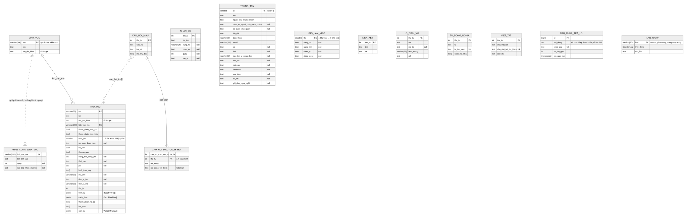

# ERD — cơ sở dữ liệu

Trạng thái: **bản theo plan** `.specify/specs/F01-nhap-du-lieu/plan.md` §4, cập nhật 2026-10-12 sau khi người dùng trả lời 10 câu nhóm A. Khi đã code, nguồn sự thật là migration EF Core trong `src/BackEnd/DichVuCong.Data/Migrations/`; file này cập nhật theo.

PostgreSQL 18, một schema, tên bảng/cột snake_case. Extension: `unaccent`, `pg_trgm`. 15 bảng.

`erd.svg` chưa vẽ lại — vẫn là bản 2026-10-09 (còn `uu_tien`, `thuong_gap`, thiếu `chu_de_goi_y`, `thanh_phan_ho_so` còn là `text[]`). Sơ đồ mermaid dưới đây là bản đúng.

```mermaid
erDiagram
  LINH_VUC ||--o{ THU_TUC : "linh_vuc_ma"
  LINH_VUC ||..o| PHAN_CONG_LINH_VUC : "ghép theo mã, không khoá ngoại"
  LINH_VUC ||..o{ CHU_DE_GOI_Y : "ghép theo mã, không khoá ngoại"
  CAU_HOI_MAU ||--|{ CAU_HOI_MAU_CACH_HOI : "xoá kèm"
  CAU_HOI_MAU }o..o{ THU_TUC : "ma_thu_tuc[]"

  THU_TUC {
    varchar(20) ma PK
    text ten
    text ten_tim_kiem "GIN trgm"
    varchar(200) linh_vuc_ma FK
    bool thuoc_danh_muc_xa
    bool thuoc_danh_muc_tinh
    smallint muc_do "1 Toàn trình, 2 Một phần"
    text co_quan_thuc_hien "null"
    text yeu_cau_dieu_kien "null"
    text trang_thai_cong_bo "null"
    text thoi_han "null"
    text phi "null"
    text[] hinh_thuc_nop
    varchar(30) ma_dvc "null"
    text don_vi_ten "null"
    varchar(30) don_vi_ma "null"
    int thu_tu
    int thu_tu_thuong_gap UK "null = không thường gặp"
    jsonb trinh_tu "BuocTrinhTu[]"
    jsonb cach_thuc "CachThucNop[]"
    jsonb thanh_phan_ho_so "GiayTo[]"
    text[] ket_qua
    jsonb can_cu "VanBanCanCu[]"
  }
  LINH_VUC {
    varchar(200) ma PK "tạo từ tên, vd ho-tich"
    text ten
    text ten_tim_kiem "GIN trgm"
  }
  PHAN_CONG_LINH_VUC {
    varchar(200) linh_vuc_ma PK
    text ten_linh_vuc
    int quay "null"
    text noi_tiep_nhan_chuyen "null"
  }
  NHAN_SU {
    int thu_tu PK
    text ho_ten
    varchar(20) xung_ho "null"
    text chuc_vu "null"
    int quay "null"
    text mo_ta "null"
  }
  TRUNG_TAM {
    smallint id PK "luôn = 1"
    text ten
    text nguoi_chiu_trach_nhiem
    text chuc_vu_nguoi_chiu_trach_nhiem "null"
    text co_quan_chu_quan "null"
    text dia_chi
    varchar(30) dien_thoai
    varchar(254) email
    text xa "null"
    text tinh "null"
    varchar(30) ma_don_vi_cong_dvc "null"
    text ban_do "null"
    text zalo_oa "null"
    text facebook "null"
    text you_tube "null"
    text tik_tok "null"
    text ghi_chu_ngay_nghi "null"
  }
  GIO_LAM_VIEC {
    smallint thu PK "1 Thứ Hai … 7 Chủ nhật"
    time sang_tu "null"
    time sang_den "null"
    time chieu_tu "null"
    time chieu_den "null"
  }
  LIEN_KET {
    int thu_tu PK
    text ten
    text url
  }
  O_DICH_VU {
    int thu_tu PK
    text ten
    text mo_ta "null"
    varchar(30) bieu_tuong
    text url "null = chưa có link"
  }
  CAU_HOI_MAU {
    int thu_tu PK
    text cau_hoi
    text tra_loi "null"
    smallint muc_trung_tam "null; 1 Địa chỉ … 5 Nộp trực tuyến"
    text[] ma_thu_tuc
  }
  CAU_HOI_MAU_CACH_HOI {
    int cau_hoi_mau_thu_tu PK, FK
    int thu_tu PK "1 = câu chính"
    text noi_dung
    text noi_dung_tim_kiem "GIN trgm"
  }
  CHU_DE_GOI_Y {
    int thu_tu PK
    varchar(50) ten_hien_thi
    text ten_linh_vuc
    varchar(200) linh_vuc_ma
  }
  TU_DONG_NGHIA {
    int thu_tu PK
    text tu
    text tu_tim_kiem UK
    text[] cach_noi_khac
  }
  VIET_TAT {
    int thu_tu PK
    text chu_viet_tat
    text chu_viet_tat_tim_kiem UK
    text day_du
  }
  CAU_CHUA_TRA_LOI {
    bigint id PK
    text noi_dung "đã che thông tin cá nhân, tối đa 500"
    text khoa_gop UK
    int so_lan_gap
    timestamptz lan_gap_cuoi "index; giữ 90 ngày"
  }
  LAN_NHAP {
    varchar(20) loai PK "thu-tuc, phan-cong, trung-tam, tro-ly"
    timestamptz thoi_diem
    text ten_file
  }
```

## Bảng theo nhóm

| Nhóm | Bảng | Dùng cho | Ghi bởi |
|---|---|---|---|
| Thủ tục | `thu_tuc` (gồm thứ tự thường gặp), `linh_vuc` | F03, F04, F05, F06 | Lệnh nhập `thu-tuc` |
| Phân công | `phan_cong_linh_vuc`, `nhan_su` — có thể rỗng | F05, F06 | Lệnh nhập `phan-cong` |
| Trung tâm | `trung_tam`, `gio_lam_viec`, `lien_ket`, `o_dich_vu` | F02, F06, F08 | Lệnh nhập `trung-tam` |
| Trợ lý | `cau_hoi_mau`, `cau_hoi_mau_cach_hoi`, `chu_de_goi_y`, `tu_dong_nghia`, `viet_tat` | F06, F07 | Lệnh nhập `tro-ly` |
| Nhật ký | `cau_chua_tra_loi` | F06 ghi; F01 xuất Excel | F06 ghi; việc định kỳ trong API xoá câu quá 90 ngày |
| Theo dõi | `lan_nhap` | F08 ("dữ liệu cập nhật ngày …"); khoá cache và ETag của API (F00) | Mọi lệnh nhập |

## Ghi chú thiết kế

- **Danh sách con của thủ tục** có nhiều trường (trình tự, cách thức, thành phần hồ sơ, căn cứ) lưu `jsonb`; danh sách chỉ có tên (kết quả, hình thức nộp) lưu `text[]`. Lý do: chỉ đọc nguyên cụm khi mở popup hoặc khi trợ lý trả lời một mục, không truy vấn quan hệ.
- **Kiểu JSON:**
  - `BuocTrinhTu { truong_hop?, noi_dung }`
  - `CachThucNop { hinh_thuc?, thoi_han?, phi?, mo_ta? }`
  - `GiayTo { ten, ban_chinh?, ban_sao? }` — null là chưa ghi số bản; nguồn ghi 0 và 0 thì lưu null
  - `VanBanCanCu { so_ky_hieu?, trich_yeu? }` — không lưu link văn bản (giống Vàm Cỏ)
- **Thủ tục thường gặp** là cột `thu_tu_thuong_gap` (null = không thường gặp), cùng lệnh nhập với thủ tục. Không có cột "ưu tiên" (bỏ 2026-10-12).
- **Cột `*_tim_kiem`** = `TiengViet.ChuanHoaTimKiem(cột gốc)`, do công cụ nhập tính; có index GIN `gin_trgm_ops` để trợ lý tìm gần đúng ("khai sjnh"). Chữ được bỏ ký tự vô hình (gồm U+200E, U+200F) trước khi lưu.
- **`phan_cong_linh_vuc`, `chu_de_goi_y` không có khoá ngoại** sang `linh_vuc`: các bảng này do lệnh nhập khác ghi, nhập lại file thủ tục không được xoá mất phân công quầy hay chủ đề gợi ý.
- **`cau_hoi_mau.ma_thu_tuc`** là mảng mã, không phải khoá ngoại — câu hỏi mẫu vẫn giữ khi danh mục thủ tục được nhập lại.
- **`cau_hoi_mau`** có đúng một trong hai: `tra_loi` (câu trả lời viết sẵn) hoặc `muc_trung_tam` (trả lời bằng thông tin Trung tâm đọc lúc hỏi).
- **CHECK chính:** `thuoc_danh_muc_xa OR thuoc_danh_muc_tinh`; `muc_do IN (1,2)`; `thu_tu_thuong_gap > 0`; `quay > 0`; `trung_tam.id = 1`; `thu BETWEEN 1 AND 7`; `(tra_loi IS NULL) <> (muc_trung_tam IS NULL)`; `muc_trung_tam BETWEEN 1 AND 5`; `so_lan_gap >= 1`; `char_length(noi_dung) <= 500`; `loai` thuộc 4 giá trị.
- `null` trong sơ đồ = cột cho phép trống. Danh sách rỗng lưu `[]`/`{}`, không lưu null.
